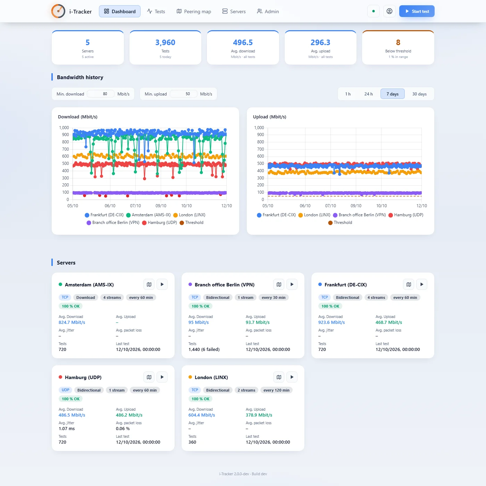
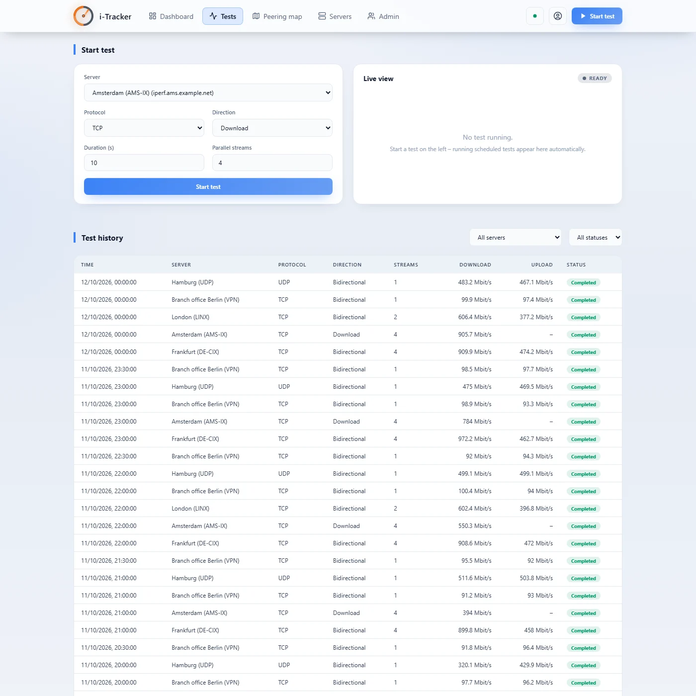
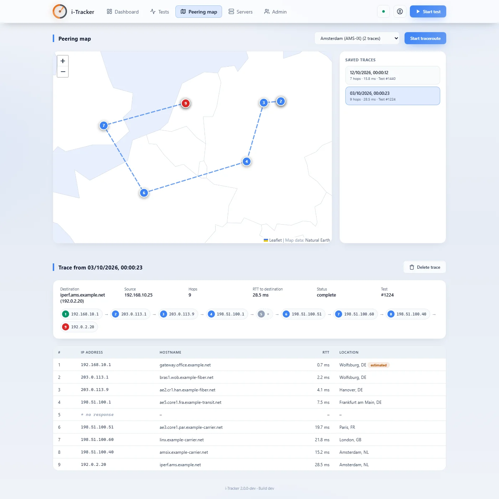
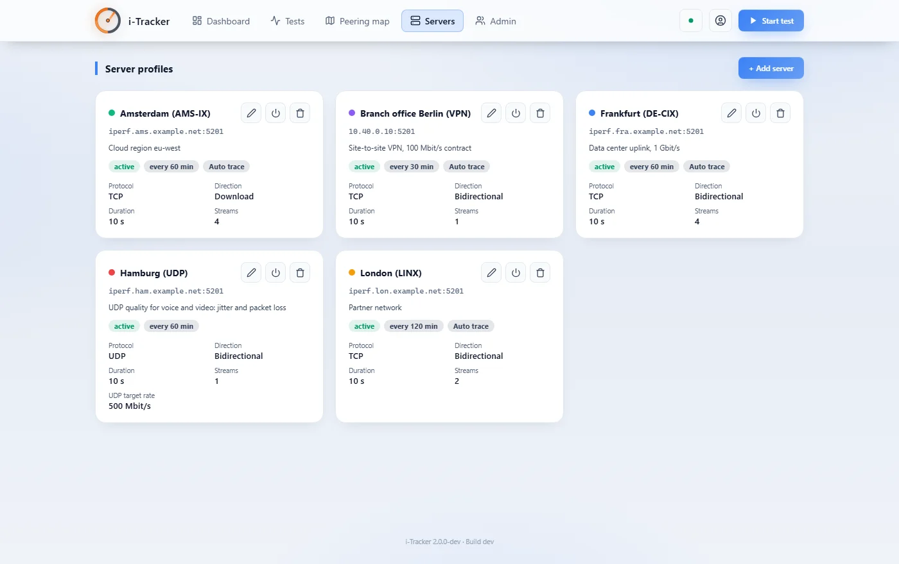
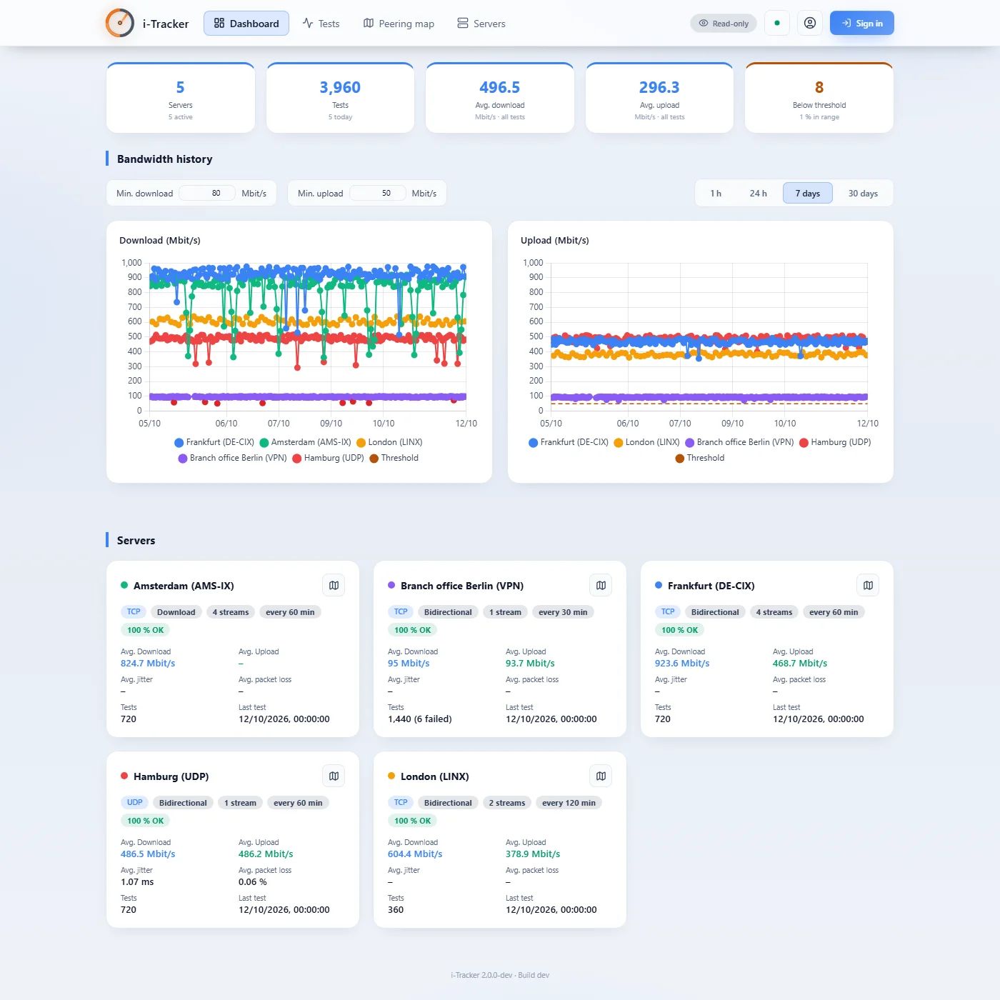

# i-Tracker

**Network bandwidth performance monitoring and tracing**

Measures bandwidth to iperf3 servers on a schedule, keeps the results as
history and shows the network path on a map. A single Go binary serves both
the API and the web interface – no additional runtime or web server needed.



## Features

- **Dashboard** – key figures, download/upload history per server with
  thresholds, live progress of running tests
- **Tests** – run tests with any parameters (TCP/UDP, download, upload,
  bidirectional, parallel streams, UDP target bandwidth), live view, test
  history with details and raw iperf3 output
- **Scheduling** – tests per server at a configurable interval, optionally
  followed by a traceroute (auto-trace)
- **Peering map** – live traceroute on a map with locations from a GeoIP
  database that is downloaded and kept up to date automatically (missing
  locations are estimated from neighbouring hops),
  path and hop table also for private networks. The world map is embedded
  (Natural Earth, vector) – it works without internet access
- **Server profiles** – your own or public iperf3 servers (selection list)
- **Administration** – users, cleanup of old data, database statistics
- **Read-only guest view** – without signing in, results can be viewed but
  not changed (can be switched off with `auth.public_read: false`)
- German and English user interface (language switch in the user menu in the
  header and with the globe on the login page; defaults to the browser
  language, otherwise German), light/dark theme (user menu or the switch on the
  login page; light unless chosen), mobile friendly. API messages follow the
  request's `Accept-Language` header or `?lang=` (German without either);
  error responses also name the message as a stable `code`
  (`{"detail": "…", "code": "err.server.not_found"}`). Logs, console output
  and command line help are English
- **No external requests** – Chart.js, Leaflet and the world map are
  embedded in the binary; the page is served with a strict
  Content-Security-Policy (`default-src 'self'`, no inline scripts or styles)


*Tests – start a test with live view, and the test history with protocol, direction, streams and throughput*


*Peering map – the path of a test across networks and exchange points, with a detour via Paris and London*


*Server profiles with schedule and auto-trace*


*Read-only guest view – the dashboard without signing in, marked "Read-only", with a "Sign in" button*

The screenshots use generated demo data: `go run ./cmd/i-tracker-demo` creates a fictitious
setup with 30 days of history and serves the real interface on it at `http://127.0.0.1:8098`
(sign in with `admin` / `demo-password`, or browse the read-only guest view).

## Requirements

- **iperf3 version 3.17 or newer** (for `--json-stream`). If iperf3 is
  missing (and `iperf.path` is not set), the web interface offers
  administrators to install it after login – via winget on Windows, via the
  available package manager on Linux (apt-get, dnf, yum, zypper, apk, pacman;
  `sudo -n` when not running as root), via Homebrew on macOS. To
  install without asking on startup, set `iperf.auto_install: true` (e.g. for
  servers where nobody uses the web interface). Manual installation:
  - Windows: `winget install ar51an.iPerf3`
  - Linux: the distribution's `iperf3` package, if it is at least 3.17
    (e.g. Debian 13: `apt install iperf3`)
- **tracert** (Windows, built in) or **traceroute** (Linux, macOS)
- Internet access to download the GeoIP database (see [GeoIP](#geoip));
  without it, traces are recorded without locations
- To build: **Go 1.24.13** or newer (`go` directive in `go.mod`)

## GeoIP

The locations on the map come from a city database in the MMDB format. It is
not part of this repository; i-Tracker downloads it on first start to
`geoip/city.mmdb` (next to `config.yaml`), checks for a newer version once a
day and swaps it in without a restart:

- **Default: [DB-IP City Lite](https://db-ip.com/db/download/ip-to-city-lite)**
  – no account needed, licensed under CC BY 4.0, updated monthly.
- **Optional: MaxMind GeoLite2 City** – somewhat more accurate. Create a free
  account at [maxmind.com](https://www.maxmind.com/en/geolite2/signup),
  generate a license key and set `geoip.maxmind_account_id` and
  `geoip.maxmind_license_key` (or `IPERF3_GEOIP_MAXMIND_LICENSE_KEY`). The
  download is verified against MaxMind's SHA-256 checksum.

The status panel of the web interface shows which database is loaded; the
map shows the attribution required by the respective license. To manage the
database yourself (e.g. with `geoipupdate`), set `geoip.auto_update: false`
and point `geoip.path` to the file. If no file exists there, an existing
`geoip/GeoLite2-City.mmdb` or `/var/lib/GeoIP/GeoLite2-City.mmdb` (the
`geoipupdate` default on Linux) is used. A GeoLite2 database placed by hand is
never replaced by DB-IP.

## Quick start (Windows)

```cmd
start.cmd
```

Builds `_release\i-tracker.exe` on the first run, starts it in the console
(stop with Ctrl+C) and opens http://localhost:8000. After code changes,
rebuild with `start.cmd rebuild` or `build.cmd release`. `build.cmd linux`
builds static Linux binaries (amd64, arm64) into `_release\linux-*\`.

First login: user **`admin`** with the **random initial password** that is
printed once to the console/log on the very first start (`initial_password=…`).
It must be changed right after signing in. See [Sign-in](#sign-in).

The binary can also be started directly by double-click. `config.yaml` and
the database (`data\`) are created next to the binary on first start, the
GeoIP database is downloaded to `geoip\`.

## Docker

```bash
docker compose up -d --build
```

One container with iperf3 3.18 and traceroute (Debian trixie); configuration
and database live in the `iperf-data` volume. The interface is available at
`http://<host>:8000`; the initial admin password is shown once by
`docker logs i-tracker`. The GeoIP database is downloaded into the volume on
first start.

> The Docker setup is prepared but not tested yet.

## Configuration

`config.yaml` (see [config.example.yaml](config.example.yaml)); every key can
be overridden with an environment variable `IPERF3_<SECTION>_<KEY>`. The
former names without prefix still work but log a deprecation warning.

| Setting | Environment variable | Deprecated alias | Default |
|---|---|---|---|
| `web.listen` | `IPERF3_WEB_LISTEN` | `LISTEN_ADDR` | `127.0.0.1:8000` if unset; the generated `config.yaml` and the Docker image set `0.0.0.0:8000` |
| `storage.path` | `IPERF3_STORAGE_PATH` | `DB_PATH` | `data/i-tracker.db` |
| `auth.secret_key` | `IPERF3_AUTH_SECRET_KEY` | `SECRET_KEY` | randomly generated into the `config.yaml` created on first start; if empty, a new random key on every start (sign-ins do not survive a restart) |
| `auth.session_ttl` | `IPERF3_AUTH_SESSION_TTL` | – | `12h` (session lifetime without activity, sliding; at least `1m`) |
| `auth.public_read` | `IPERF3_AUTH_PUBLIC_READ` | – | `true` (read-only guest view without sign-in, see [Sign-in](#sign-in)) |
| `scheduler.enabled` | `IPERF3_SCHEDULER_ENABLED` | `SCHEDULER_ENABLED` | `true` |
| `iperf.path` | `IPERF3_IPERF_PATH` | `IPERF3_PATH` | auto-detected (PATH, winget location) |
| `iperf.auto_install` | `IPERF3_IPERF_AUTO_INSTALL` | `IPERF3_AUTO_INSTALL` | `false` (the web interface asks first) |
| `geoip.path` | `IPERF3_GEOIP_PATH` | `GEOIP_PATH` | `geoip/city.mmdb` |
| `geoip.auto_update` | `IPERF3_GEOIP_AUTO_UPDATE` | – | `true` (download and keep the database up to date) |
| `geoip.maxmind_account_id` | `IPERF3_GEOIP_MAXMIND_ACCOUNT_ID` | – | empty = DB-IP City Lite (set both MaxMind keys or neither) |
| `geoip.maxmind_license_key` | `IPERF3_GEOIP_MAXMIND_LICENSE_KEY` | – | empty = DB-IP City Lite |
| `map.tile_url` | `IPERF3_MAP_TILE_URL` | – | empty = embedded offline world map |
| `map.tile_attribution` | `IPERF3_MAP_TILE_ATTRIBUTION` | – | OpenStreetMap notice |
| `update.mode` | `IPERF3_UPDATE_MODE` | – | `auto` (`auto`, `notify` or `off`, see [Updates](#updates)) |
| `update.interval` | `IPERF3_UPDATE_INTERVAL` | – | `6h` (at least `1m`) |
| `update.window` | `IPERF3_UPDATE_WINDOW` | – | empty = any time (e.g. `02:00-05:00`, local time) |
| `log.level` | `IPERF3_LOG_LEVEL` | `LOG_LEVEL` | `info` (`debug`, `info`, `warn`, `error`) |
| `log.format` | `IPERF3_LOG_FORMAT` | – | `text` (`text` or `json`) |

Relative paths are resolved against the directory of `config.yaml`. Log keys
are English (`path`, `error`, …), messages are German.

**Listen address:** without a `web.listen` entry the service only listens on
`127.0.0.1:8000`. The `config.yaml` created on first start and the Docker
setup set `0.0.0.0:8000` explicitly, so existing installations keep being
reachable from the network.

**Map:** by default the peering map draws an embedded world map (Natural Earth
1:110m, public domain) and loads nothing from the internet. If you run your
own tile server, set `map.tile_url` (e.g.
`https://tiles.example.org/{z}/{x}/{y}.png`); its origin is then added to the
Content-Security-Policy (`img-src`).

## Sign-in

- **Guest view:** with `auth.public_read: true` (default), visitors who are
  not signed in see the dashboard, test results, live progress of running
  tests, peering map with saved traces and server profiles as a read-only
  page, marked "Read-only", with a "Sign in" button in the header (see the
  screenshot above). Everything that changes something (running tests or
  traceroutes, editing servers, deleting tests or traces, administration,
  iperf3 installation) requires a sign-in and is rejected by the API with
  `401` (the live traceroute stream answers with an error event). Guests do
  not get the raw iperf3 output, local paths, the iperf3 install command or
  any user data. Set `auth.public_read: false` (or
  `IPERF3_AUTH_PUBLIC_READ=false`) to require a sign-in for everything, e.g.
  when traces should not reveal your network paths to anyone who can reach
  the page.
- There is no fixed default password. On the first start (empty database) the
  user `admin` is created with a random password that is logged once
  (`initial_password=…`; when running as a service additionally written to
  `initial-admin-password.txt` next to `config.yaml` – delete it afterwards).
  The password must be changed at the first sign-in; until then the API
  rejects everything else (the account only gets the guest view, if enabled).
- Installations that still use the former default `admin123` are forced to
  change it at the next sign-in.
- Passwords are hashed with Argon2id. Older bcrypt hashes are still accepted
  and transparently re-hashed at the next successful sign-in.
- New passwords need at least 10 characters and at most 256 bytes (existing
  shorter ones keep working until they are changed).
- After 10 failed attempts (wrong password at sign-in or wrong current
  password when changing it) within 5 minutes, the client address gets
  `429 Too Many Requests` (with `Retry-After`) until the oldest attempt is
  5 minutes old; a successful sign-in does not reset the count. Only the
  TCP peer address counts (`X-Forwarded-For` is ignored), so behind a reverse
  proxy all clients share one limit.
- Sessions expire after `auth.session_ttl` (default 12 h) without activity;
  with activity the session cookie is renewed once more than half of it has
  passed. Signing out (`POST /api/auth/logout`) revokes the token, also when
  sent as Bearer token. Changing the password ends all other sessions of the
  user; `POST /api/auth/logout-all` ends all of them. Revoked single sessions
  are kept in memory only – after a restart a signed-out, not yet expired
  token would be accepted again (password change and logout-all survive
  restarts).
- The web interface keeps the session in an HttpOnly cookie
  (`iperf3_session`, `SameSite=Lax`; `Secure` and `__Host-` prefix behind
  HTTPS / `X-Forwarded-Proto: https`). Changing requests need the CSRF token
  (`csrf_token` from the login response, header `X-CSRF-Token`); cross-site
  requests are rejected. API clients can still use
  `Authorization: Bearer <access_token>` from the login response. Bearer
  tokens are not renewed; after a password change use the new `access_token`
  from the response.

## Command line and service

```text
i-tracker [-config config.yaml] [-version] [-no-tui]
i-tracker service install|uninstall|start|stop|restart|status [-config path]
i-tracker rollback
```

`service install` registers a Windows service / systemd unit / launchd job
(default config: `config.yaml` next to the binary). As a Windows service the
log goes to `i-tracker.log` next to the configuration. `-no-tui` is
accepted for consistency with the other wedigo products but has no effect.
`GET /health` (`status`, `scheduler_running`) and `GET /api/info` (`name`,
`version`, `build_date`) need no sign-in.

## Updates

i-Tracker updates itself from a signed release feed at
`https://www.wedigo.net/update/i-tracker/` (`latest.json`, Ed25519 signature
in `latest.json.sig` checked against the wedigo release key built into the
binary, SHA-256 per binary). There is one channel for all versions, so moving
from 0.x to 1.x is an ordinary update.

- `update.mode: auto` (default) installs a new release and restarts the
  service, within `update.window` if set; `notify` only reports it (admins
  install it under **Admin → Software update**); `off` never checks.
- Automatic installs need a service (Windows service or systemd unit), a
  writable program folder and a release build (`git describe` on a clean
  tag). Development builds, foreground runs and containers
  (`IPERF3_CONTAINER=1`, set by the Docker image) are never replaced
  automatically.
- The previous binary stays as `i-tracker.exe.bak` (`i-tracker.bak` on
  Linux). A new version that fails to start, or crashes three times before
  running healthy for two minutes, is rolled back automatically and not
  installed again. `i-tracker rollback` restores the previous version by hand;
  restart the service afterwards. An automatic rollback keeps the failed binary
  as `i-tracker.exe.failed`, not as the backup, so a manual rollback afterwards
  refuses instead of reinstalling it.

## Development

```cmd
go test ./...
go run ./cmd/i-tracker
```

| Directory | Contents |
|---|---|
| `cmd/i-tracker` | entry point |
| `cmd/i-tracker-demo` | demo data generator for screenshots and demos: fictitious setup in documentation address ranges, 30 days of history, real interface on `127.0.0.1:8098` (`-db`, `-listen`, `-days`, `-seed-only`) |
| `internal/web` | HTTP API, live trace and live test progress (server-sent events), sessions/CSRF, embedded web interface (`static/`, libraries in `static/vendor/`) |
| `internal/auth` | Argon2id passwords, session tokens, CSRF tokens |
| `internal/config` | `config.yaml`, `IPERF3_*` environment variables |
| `cmd/i-tracker-feed` | builds the signed update feed of a release (vendor tool, not shipped) |
| `internal/svc` | operating-system service (kardianos/service), recovery actions, detached restart |
| `internal/selfupdate` | self-update: signed feed, install, automatic rollback |
| `internal/iperf` | running iperf3, evaluating `--json-stream`, installation |
| `internal/trace` | tracert/traceroute, GeoIP lookup and download, location interpolation |
| `internal/scheduler` | per-server schedule, auto-trace |
| `internal/store`, `internal/db` | SQLite (pure Go driver, no CGO) |
| `internal/i18n` | translation of API messages (German/English) |
| `internal/model` | shared data types |
| `internal/version` | name, version, build date (set via `-ldflags`) |
| `geoip/` | download location of the GeoIP database (not in the repository) |
| `_screenshots/` | README screenshots (made with `cmd/i-tracker-demo`) |

The web interface follows the shared wedigo design tokens
(`static/wedigo-tokens.css`, shared with the other wedigo products) and the
Spherifyer design language. Chart.js 4.4.1, Leaflet 1.9.4 and the Natural
Earth world map are vendored in `internal/web/static/vendor/` together with
their licences (see the README there); nothing is loaded from a CDN.

## License

i-Tracker is free software licensed under the GNU Affero General Public
License v3.0, see [LICENSE](LICENSE). Anyone who modifies i-Tracker and
offers it to others, including as a network service, must make the modified
source code available under the same license.

Third-party components and their license texts: [THIRD-PARTY-NOTICES.md](THIRD-PARTY-NOTICES.md).

## Licences of embedded components

Web interface (vendored, see `internal/web/static/vendor/README.md`):

- Chart.js 4.4.1 – MIT
- Leaflet 1.9.4 – BSD-2-Clause
- Natural Earth (Admin 0 Countries 1:110m) – public domain

Go modules compiled into the binary (versions in `go.mod`):

- golang-jwt/jwt – MIT
- kardianos/service – zlib
- golang.org/x/crypto, golang.org/x/sys – BSD-3-Clause
- gopkg.in/yaml.v3 – MIT and Apache-2.0
- modernc.org/sqlite, libc, mathutil, memory – BSD-3-Clause (SQLite itself is
  public domain)
- oschwald/geoip2-golang, oschwald/maxminddb-golang – ISC
- dustin/go-humanize, mattn/go-isatty, ncruces/go-strftime – MIT
- remyoudompheng/bigfft, google/uuid (Linux/macOS builds) – BSD-3-Clause

## GeoIP notice

By default, i-Tracker uses
[IP Geolocation by DB-IP](https://db-ip.com), licensed under
[CC BY 4.0](https://creativecommons.org/licenses/by/4.0/).

When configured with MaxMind credentials, this product includes GeoLite2 data
created by MaxMind, available from https://www.maxmind.com.
